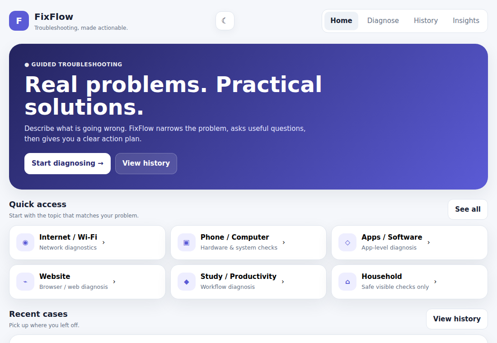
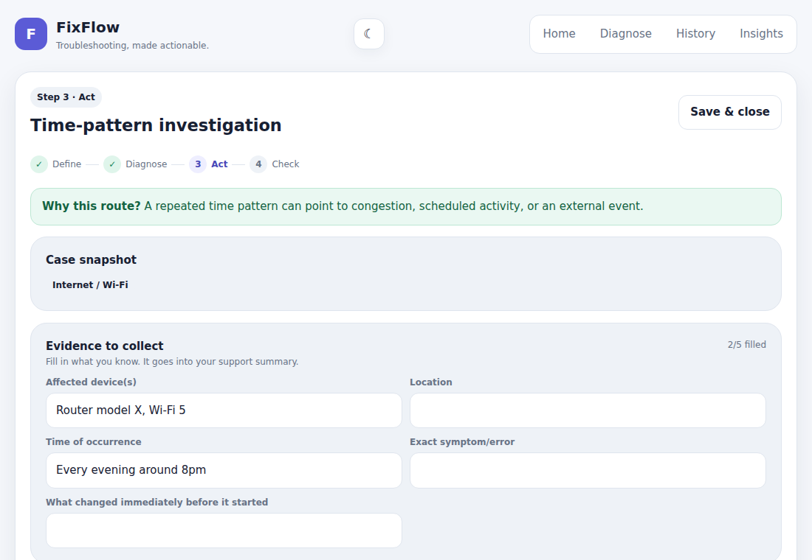

# FixFlow

**Troubleshooting, made actionable.** FixFlow turns "something is wrong" into a structured investigation: it asks the right questions, routes you to a tailored action plan, and keeps your evidence so you can hand a clear record to support. It works offline, installs like an app, and keeps all data on your device.

<p align="center">
  
  
</p>

## Why it exists

Most troubleshooting advice is a pile of random fixes. Changing five things at once means you never learn which one mattered, and by the time you contact support you have forgotten what you tried. FixFlow enforces a simple discipline: **define, diagnose, act, check**, one change at a time, with notes.

## Features

- **Guided diagnosis** across 7 categories (Internet/Wi-Fi, Phone/Computer, Apps/Software, Website, Study/Productivity, Household, Other). 3 to 4 questions route each problem to one of 6 to 8 tailored action plans.
- **Action plans with a reason for every step**: each step explains what to do and why, and you mark it as helped, no change, or worse.
- **Evidence checklist**: fill in device, location, timing, exact error and more. It flows into the support summary.
- **Incident log**: one-tap timestamps each time the problem happens, so patterns show up.
- **Photos and screenshots**: attach up to 6 images per case (resized on-device and stored in IndexedDB, so they don't use up the ~5 MB `localStorage` limit; older inline photos migrate automatically).
- **Support summary**: copy a clean, complete report of the case for a helpdesk or a friend.
- **Case history** with search, status and category filters, resume, delete with **Undo**, and editing of a case's title and description after the plan is built.
- **PDF report**: save any case as a clean, print-ready PDF (steps, results, evidence, incident log, photos) from the plan, outcome or history screens.
- **Autosaved drafts**: what you type is saved as you go, so a reload or closed tab never loses a case.
- **Back button and deep links**: every screen has its own URL (`#/history`, `#/analytics`, and so on), its own page title, and moves keyboard focus to the new heading. A skip-to-content link is included.
- **Insights**: resolution rate and outcomes across your cases.
- **Safety-aware**: household mode is limited to safe visible checks and stops at electricity, gas, fire and similar hazards. A "safety concern" urgency level shows an emergency notice.
- **Backup and restore**: export all cases as JSON and import them back (merged, not overwritten).
- **Light and dark themes**, visible keyboard focus and ARIA labels on controls.
- **Installable and offline-first** (PWA).

## How the diagnosis works

```
Define the problem  ->  Answer 3-4 yes/no questions  ->  Routed to a plan  ->  Act, note results  ->  Close with an outcome
```

Each category has its own playbook: a short question set, and a set of branches (for example, for Wi-Fi: *device-side*, *signal/coverage*, *time-pattern*, *router-related*, *persistent*). The answers decide the branch by a small, deterministic rule, so the same answers always give the same plan and you can see why ("Why this route?").

## Privacy

Everything is stored in your browser (`localStorage`) on your device. The app makes no network requests of its own: no accounts, no analytics, no servers. Export a backup if you want to move cases between devices.

## Run it locally

No build step is needed to *use* the app. It is plain HTML, CSS and JavaScript.

```bash
# any static server works; the service worker needs http://localhost (not file://)
python3 -m http.server 8000      # or: npm run serve
# then open http://localhost:8000
```

Opening `index.html` straight from disk also works, just without the offline and install features. `dist/fixflow-single.html` is the whole app in one file, handy for sharing.

## Install as an app

Open the hosted site in Chrome, Edge or Safari and use **Install app** (footer button, or the browser's install / "Add to Home Screen" option). After the first visit it loads with no connection.

## Deploy for free

**GitHub Pages**
1. Create a repository and push these files to the `main` branch.
2. Repository Settings, then Pages, then deploy from branch `main`, folder `/ (root)`.
3. Your app is live at `https://<your-username>.github.io/<repo-name>/`.

**Netlify or Vercel**: drag the folder onto the dashboard, or connect the repository. No build command is needed and the publish directory is the project root.

When you change any cached file, bump `VERSION` in `sw.js` so installed copies pick up the update (users see a "new version ready" prompt).

## Project structure

```
index.html              page shell
css/styles.css          styles (light and dark themes, print layout for PDF reports)
data/playbooks.json     SOURCE OF TRUTH: categories, questions, branches, steps, evidence
js/data.js              generated from the JSON (do not edit)
js/core.js              pure logic, no DOM: routing, case cleanup, merge, filters, stats, summary, report HTML, escaping
js/imagedb.js           photo storage in IndexedDB (with an inline fallback)
js/state.js             app state and localStorage persistence
js/ui.js                views, rendering and user actions
js/events.js            global event wiring
js/pwa.js               install prompt, offline badge, update flow
js/main.js              start-up
sw.js                   service worker: offline app shell, versioned cache, update flow
manifest.webmanifest    PWA manifest
scripts/                build-data.js (JSON -> js/data.js), bundle.js (single-file build)
tests/                  unit tests (Node) and browser end-to-end tests (Playwright)
.github/workflows/      CI: unit tests on Node 20 and 22, browser tests in Chromium
dist/                   generated single-file build
```

## Editing the playbooks

All troubleshooting content lives in `data/playbooks.json`, so you can add or improve a plan without touching code.

```bash
# 1. edit data/playbooks.json
npm run build        # regenerates js/data.js and the single-file build
npm test             # checks the data is complete and every branch is reachable
```

A new branch needs a `title` and at least 3 steps, each with a `title`, an `action` and an explanation (`detail`). The tests fail if a step is missing its explanation. If you add a branch, also update the routing rule for that category in `js/core.js`, or the tests will tell you the branch is unreachable.

## Testing

```bash
npm test             # 49 unit tests, no dependencies (Node 20+)
npm run test:e2e     # 70 browser checks in real Chromium (pip install playwright && playwright install chromium)
```

The unit tests cover:
- **Data integrity**: every category, question, branch and step is complete, and every answer button has a label.
- **Routing**: every answer combination reaches a real branch, every branch is reachable, plus scenario tests that document the intended logic. A possible household hazard always wins.
- **Case hygiene**: `normalizeCase` is tested with hostile and broken input (script-injection ids, wrong types, fake image data) because imported backups are untrusted.
- **Merging, filtering, stats and the support summary.**
- **Packaging**: the service worker caches every file the page loads, the manifest is installable, and generated files are up to date.

The browser tests run the real app: offline loading, the full case flow, all 72 category and answer combinations, image attachments, backup import, and mobile layout.

CI (`.github/workflows/ci.yml`) runs both suites on every push and pull request. It is included in the repo and starts working as soon as you push to GitHub.

## Roadmap

- Hindi and other languages (a translation layer for the UI and playbooks)
- Optional AI-assisted intake, with the rule-based playbooks staying as the safe default

## Disclaimer

FixFlow gives general guidance only. It is not a substitute for a qualified professional. If there is smoke, a burning or gas smell, sparks, flooding near electricity, or anyone could be hurt, stop and call your local emergency number.
